# Cascade Virality Predictor from Propagation Structure

Early-window prediction of information cascade virality from **propagation tree structure and edge timestamps only**.

> [!IMPORTANT]
> **What this system predicts:** Propagation behaviour (whether an observed early cascade will reach the upper tail of cascade sizes). It does **not** judge whether information is true or false and must **never** be described as fake-news or rumor detection.
>
> **Scope & generalization:** Results are valid only on the specific public dataset(s) and time period trained on; they do not generalize automatically across platforms or eras. No synthetic dataset fallback exists anywhere in the app.

## Architecture

```mermaid
flowchart LR
  Raw["Real Dataset (backend/data/raw/)"] --> Adapter["DatasetAdapter -> Canonical Edge List"]
  Adapter --> Valid["Validation & Cleaning Service"]
  Valid --> Split["Temporal Split (70/10/20) + Early Window T"]
  Split --> Feats["18 Structural & Temporal Features"]
  Feats --> Train["RF + LogReg + Naive(num_edges) + Dummy"]
  Train --> Artifacts["models/*.joblib + reports/metrics.json"]
  Artifacts --> API["FastAPI (/api/health, /cascades, /validate, /predict, /report)"]
  API --> Web["React 18 + TS + d3-hierarchy + Recharts (3 Pages)"]
```



## Prerequisites (Windows 10/11 PowerShell)

- Python 3.11+
- Node.js 20+ and npm

## Obtaining a Real Dataset (Not Redistributed)

Place one of the supported real datasets under `backend/data/raw/`:

1. **Ma et al. Twitter15 / Twitter16** (`backend/data/raw/twitter15/tree/*.txt`):
   - Mirror / original research repositories such as `majingCUHK/Rumor_RvNN` or `gszswork/Twitter15_16_dataset` (subject to Twitter/X research terms; non-commercial academic use).
   - Veracity labels (`label.txt`) and tweet text (`source_tweets.txt`) are ignored; only `tree/*.txt` parent-child links and minute delays are read.
2. **PHEME Conversation Trees** (`backend/data/raw/pheme/`):
   - Hosted on Figshare (annotations CC-BY 4.0; tweets subject to Twitter/X terms). Uses `structure.json` and `created_at` timestamps only.
3. **Canonical Edge CSV** (`backend/data/raw/<name>/edges.csv`):
   - Any real cascade dataset formatted with headers `cascade_id,parent_id,child_id,timestamp` (seconds since root; root has empty `parent_id`).

See [docs/data-sources.md](docs/data-sources.md) for licenses, citations, and known data limitations.

## Run Commands (Windows PowerShell)

The backend and frontend start cleanly even before any dataset or trained model exists, displaying explicit empty-state setup instructions.

```powershell
# Terminal 1: Backend setup, training (once dataset is placed), tests, and API
cd backend
python -m venv .venv
.venv\Scripts\Activate.ps1
python -m pip install -e ".[dev]"
python -m ruff check app tests
python -m mypy app
python -m pytest -q
python -m app.ml.train --dataset twitter15   # once dataset is placed
python -m uvicorn app.main:app --reload

# Terminal 2: Frontend setup, OpenAPI typegen, dev server, tests, and build
cd frontend
npm install
npm run gen:api
npm run dev
npm run test
npm run build
```

Or launch both dev servers together from the repository root:

```powershell
.\scripts\dev.ps1
```

## Project Structure

- `backend/app/config.py`, `errors.py`, `schemas.py` — frozen settings, error envelope, Pydantic v2 contracts
- `backend/app/services/` — canonical CSV validation, graph builder, 18-feature extractor, explanation proxy, model store
- `backend/app/ml/` — dataset adapters (`twitter15_16.py`, `pheme.py`, `canonical_csv.py`), training-only labeling, temporal split, evaluation & CLI trainer
- `backend/app/routers/` — `/api/health`, `/api/model/info`, `/api/cascades`, `/api/cascades/{id}`, `/api/validate`, `/api/predict`, `/api/report`
- `frontend/src/` — 3 pages (`AnalyzePage`, `ReportPage`, `AboutPage`), `TreeView` (`d3-hierarchy` + SVG), `UploadZone`, `ProbabilityGauge`, typed OpenAPI client
- `docs/` — [methodology.md](docs/methodology.md), [data-sources.md](docs/data-sources.md), [viva-questions.md](docs/viva-questions.md)

## API Summary

| Method | Path | Purpose |
|---|---|---|
| `GET` | `/api/health` | Liveness, `model_loaded`, `dataset_loaded` |
| `GET` | `/api/model/info` | Features, threshold, window `T`, dataset hash, split dates |
| `GET` | `/api/cascades?limit&offset&search` | Paginated real cascades with early/final size |
| `GET` | `/api/cascades/{id}` | Early-window tree nodes/edges (capped at 1000 nodes) |
| `POST` | `/api/validate` | Validate uploaded canonical CSV and return `ValidationReport` |
| `POST` | `/api/predict` | Predict virality from CSV upload or `{ "cascade_id": "..." }` |
| `GET` | `/api/report` | Evaluation report loaded from `reports/metrics.json` |

## Limitations

- Evidence is restricted to the specific public dataset(s) and time period evaluated.
- Private messaging / dark-social shares are unobserved.
- Structure-only inputs exclude content, media, seed-account followers, and external amplification.
- Predicted virality is never a truth signal; true breaking news can spread just as virally.
- Thresholds and probability calibration drift over time; virality forecasting carries dual-use amplification risks.
